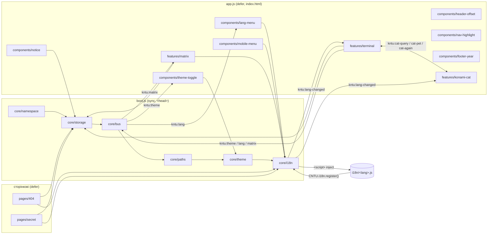

# Архітектура сайту

Статичний сайт вступної кампанії ЦНТУ: три сторінки, **жодного кроку збірки для браузера**.
Сайт відкривається напряму з диска (`file://`), на GitHub Pages під `/University/` і на кореневому домені — без налаштувань.

## Принципи

| Обмеження                                      | Наслідок для коду                                                                                                            |
| ---------------------------------------------- | ---------------------------------------------------------------------------------------------------------------------------- |
| `file://` блокує ES-модулі та `fetch()` (CORS) | лише класичні скрипти (`defer`), словники — теж скрипти, що підвантажуються тегом `<script>`                                 |
| без збірки в браузері                          | згенеровані бандли (`main.css`, `boot.js`, `app.js`) **комітяться**; `scripts/build.mjs` лише склеює файли, без транспіляції |
| 404 віддається на будь-якій глибині URL        | у `404.html` немає посилань на ресурси в розмітці — їх додає інлайн-завантажувач з обчисленим коренем                        |
| прогресивне покращення                         | без JS сторінка повністю придатна (меню, тексти, контакти); JS лише додає перемикачі, меню, пасхалки                         |
| один глобальний об'єкт                         | `window.CNTU` — єдина глобальна змінна; усі інші файли — IIFE                                                                |

## Дерево файлів

```
University-improved/
├── index.html · 404.html · secret.html      сторінки (корінь — вимога GitHub Pages)
├── robots.txt · sitemap.xml · site.webmanifest
├── README.md · package.json · eslint.config.js · .stylelintrc.json · .prettierignore
├── assets/
│   ├── css/
│   │   ├── main.css                 ЗГЕНЕРОВАНО (scripts/build.mjs) — підключається сторінками
│   │   ├── base/                    fonts · tokens · reset · utilities · layout · responsive · reduced-motion
│   │   ├── components/              notice · header · lang-menu · burger · hero · cards · buttons · footer
│   │   ├── features/                matrix · terminal · konami-cat
│   │   ├── print.css
│   │   └── pages/                   404.css · secret.css (підключаються напряму, лише на своїх сторінках)
│   ├── js/
│   │   ├── boot.js                  ЗГЕНЕРОВАНО з core/ — синхронно в <head>
│   │   ├── app.js                   ЗГЕНЕРОВАНО з components/ + features/ — defer, лише index.html
│   │   ├── core/                    namespace · storage · bus · paths · theme · i18n
│   │   ├── components/              lang-menu · theme-toggle · mobile-menu · header-offset · nav-highlight · notice · footer-year
│   │   ├── features/                matrix · terminal · konami-cat
│   │   ├── pages/                   404.js · secret.js (defer, напряму)
│   │   └── i18n/                    uk · en · pl · de · es · ja (ліниве завантаження)
│   ├── fonts/                       Montserrat variable (woff2: кирилиця, латиниця)
│   ├── img/                         Gerb.webp · og-cover.jpg · specialtiesTwo/
│   └── icons/                       favicon-32 · apple-touch-icon · icon-192
├── scripts/                         інструменти розробника (Node, без залежностей, крім тестів)
│   ├── build.mjs                    склеювання бандлів; --check — у npm run lint
│   ├── check-head.mjs               однаковий порядок <head> на трьох сторінках
│   ├── i18n-check.mjs               повнота словників і ключів data-i18n
│   ├── serve.mjs                    мок GitHub Pages (/University/ або корінь, 404.html зі статусом 404)
│   ├── test.mjs                     npm test: два моки + усі tests/e2e/*.test.mjs
│   └── visual-diff.mjs              піксельне порівняння 21 ключового стану (pixelmatch)
├── tests/
│   ├── helpers.mjs                  launch · check · done · wait · KONAMI · URL-и середовища
│   └── e2e/*.test.mjs               13 браузерних наборів (puppeteer-core)
└── docs/
    ├── ARCHITECTURE.md              цей файл
    ├── SECRETS.md                   спойлери: пасхалки й ланцюжок секретів
    └── CHANGELOG.md                 журнал змін
```

### Чому саме так

- **Сторінки в корені**: GitHub Pages шукає `index.html` і `404.html` саме там; `secret.html` поруч, щоб відносні шляхи були однакові.
- **`assets/` за типом, усередині — за роллю** (`base` → `components` → `features` → `pages`): від загального до часткового, той самий порядок, що й у каскаді CSS та в порядку ініціалізації JS.
- **Склеювання замість багатьох `<link>`/`<script>`**: дрібні файли зручні для читання, але кожен запит коштує часу на мобільних (Lighthouse). Тому джерела дрібні, а сторінка отримує 1 CSS + 2 JS. Склеювання — звичайна конкатенація в явно заданому порядку, тож вихідний файл тотожний попередньому моноліту (візуальний diff — 0 px).
- **Згенероване комітиться**: сайт працює без Node.js; `npm run lint` (`build --check`) гарантує, що бандли не застаріли.
- **Сторінкові скрипти/стилі не в бандлі**: `404.js` і `secret.js` потрібні лише на своїх сторінках.
- **`scripts/` окремо від `tests/`**: інструменти (збірка, перевірки, сервер, раннер) — не тести; `tests/` містить лише сценарії та спільні хелпери.

## Модулі JavaScript

`window.CNTU` створюється першим файлом `core/namespace.js`; кожен наступний модуль — IIFE, що читає з нього залежності (`const { i18n, bus } = window.CNTU;`) або реєструє в ньому свій API.

| `CNTU.*`  | Файл              | Призначення                                                                      |
| --------- | ----------------- | -------------------------------------------------------------------------------- |
| `config`  | core/namespace.js | ключі сховища, мови, `DEFAULT_LANG`, `MOBILE_MEDIA`, кольори теми, префікс подій |
| `dom`     | core/namespace.js | `$`, `$$`                                                                        |
| `storage` | core/storage.js   | `local`/`session` без винятків; `secrets.list()` / `secrets.add(id)`             |
| `bus`     | core/bus.js       | `on(name, fn)` / `emit(name, detail)` → події `kntu:*` на `document`             |
| `paths`   | core/paths.js     | тека `boot.js` і словників (працює на file://, /University/ і корені)            |
| `theme`   | core/theme.js     | тема до першого рендеру; `isDark`, `render`, `set`, `saved`, `resolve`           |
| `i18n`    | core/i18n.js      | реєстр словників, `load`, `ready`, `translate`, `t`, `fill`, `apply`, `onChange` |



### Порядок завантаження

1. `<head>`: CSS → `boot.js` (синхронно, після CSS). Він додає клас `js`, застосовує тему, обирає мову й починає вантажити словник. Для мови ≠ `uk` сторінка прихована класом `i18n-pending` до перекладу (запобіжник — 3 с).
2. `defer`: `app.js` виконує модулі в порядку, заданому в `scripts/build.mjs`: спершу мова (щоб інші модулі одразу малювали правильні підписи), далі тема, меню, …, пасхалки.
3. `404.html`: інлайн-скрипт обчислює корінь сайту (`REPO = 'University'`, file:// → відносно), визначає нічний режим і додає `main.css`, `pages/404.css`, `boot.js`, `pages/404.js` з `async = false` (зберігається порядок виконання).

## Потоки даних

### Тема

```
localStorage['site-theme'] ('dark'|'light'|нема) ──► core/theme (до першого рендеру) ──► <html data-theme>, meta theme-color
кнопка #themeToggle / kntu:theme ──► CNTU.theme.set() ──► render + запис у localStorage
зміна теми ОС (якщо вибір не збережено) / подія storage (інша вкладка) ──► CNTU.theme.render()
```

### Мова

```
localStorage['site-lang'] → navigator.languages → 'uk'  ──► CNTU.i18n.initial
CNTU.i18n.load(lang) ──► <script src="assets/js/i18n/<lang>.js"> ──► CNTU.i18n.register(lang, dict)
index:  components/lang-menu → CNTU.i18n.apply(lang)  (виграє останній запит)
          → translate([data-i18n], [data-i18n-attr]) → onChange-підписники → kntu:lang-changed → зняти i18n-pending
404/архів: pages/*.js → CNTU.i18n.ready → translate(розділ notFound / archive)
```

Розділи словника: `main` (index + Matrix), `notFound`, `archive`, `terminal`, `cat`, а в `ja` — ще `jaOnly`.

### Події (`CNTU.bus`, префікс `kntu:`)

| Подія                  | Хто надсилає              | Хто слухає           |
| ---------------------- | ------------------------- | -------------------- |
| `theme {theme}`        | terminal                  | theme-toggle         |
| `lang {lang}`          | terminal                  | lang-menu            |
| `matrix`               | terminal                  | matrix               |
| `lang-changed {lang}`  | core/i18n (після `apply`) | terminal, konami-cat |
| `cat-query`, `cat-pet` | terminal                  | konami-cat           |
| `cat-again`            | konami-cat                | terminal             |

Це звичайні DOM-події, тож їх можна надсилати з тестів чи DevTools: `document.dispatchEvent(new CustomEvent('kntu:matrix'))`.

### Сховище

| Ключ               | Де             | Значення                                             |
| ------------------ | -------------- | ---------------------------------------------------- |
| `site-theme`       | localStorage   | `dark` / `light` (лише явний вибір)                  |
| `site-lang`        | localStorage   | код мови (лише явний вибір; старе `ua` → `uk`)       |
| `site-secrets`     | localStorage   | JSON-масив досягнень (див. [SECRETS.md](SECRETS.md)) |
| `notice-dismissed` | sessionStorage | `true`, коли повідомлення закрито                    |

## Стандарти коду

- JS: `'use strict'`, IIFE, `const`, константи на початку файлу (без «магічних чисел»), ранні `return`, JSDoc для публічних функцій, `camelCase` / `UPPER_SNAKE` для констант.
- CSS: BEM (`block__element--modifier`), стани `.is-*`, токени в `base/tokens.css`, логічні властивості (`inline`/`block`).
- HTML: однаковий порядок `<head>` (перевіряє `scripts/check-head.mjs`): charset → viewport → robots → title → description → canonical → theme-color → color-scheme → критичний стиль → соцмережі → іконки → manifest → preload → `main.css` → CSS сторінки → `boot.js` → `defer`-скрипти.

## Як додати…

### Мову

1. Скопіювати `assets/js/i18n/en.js` у `assets/js/i18n/<код>.js`, змінити `register('<код>', …)` і перекласти.
2. Додати код у `LANGS` і рідну назву в `LANG_NAMES` (`assets/js/core/namespace.js`), двобуквений код кнопки — у `LANG_CODES` (`components/lang-menu.js`).
3. Додати пункт `<li role="none"><button class="lang-menu__item" role="menuitemradio" data-lang="<код>" lang="<код>">…` у `index.html`.
4. `npm run build && npm run lint` — `i18n-check` покаже пропущені ключі.

### Пасхалку (або іншу функцію на index)

1. Стилі: `assets/css/features/<назва>.css`; додати в список `main.css` у `scripts/build.mjs` (перед `base/reduced-motion.css`, якщо потрібне вимкнення анімацій).
2. Скрипт: `assets/js/features/<назва>.js` у вигляді IIFE, залежності — лише з `window.CNTU`; зв'язок з іншими модулями — через `CNTU.bus` (нова подія `kntu:<назва>`); тексти — в розділі словника для **всіх** мов; досягнення — `CNTU.storage.secrets.add('<id>')`.
3. Додати файл у список `app.js` у `scripts/build.mjs`, виконати `npm run build`.
4. Тест: `tests/e2e/<назва>.test.mjs` з хелперами з `tests/helpers.mjs`.

### Сторінку

1. `<назва>.html` у корені з `<head>` у загальному порядку (див. вище): `main.css`, за потреби `assets/css/pages/<назва>.css`, `boot.js`, `assets/js/pages/<назва>.js` (`defer`).
2. Тексти — новий розділ словника (усі 6 мов) і `data-i18n`; додати сторінку в `PAGES` у `scripts/i18n-check.mjs` та `scripts/check-head.mjs`.
3. Якщо сторінка публічна — `sitemap.xml`; інакше `noindex`.
4. Перевірити на file://, `npm run serve:pages` і в `tests/e2e/hosting.test.mjs`.

## Перевірки

```
npm run build      # оновити згенеровані бандли
npm run lint       # build --check · Prettier · ESLint · Stylelint · html-validate · check-head · i18n-check
npm test           # 13 браузерних наборів (GitHub Pages мок, кореневий домен, file://)
node scripts/visual-diff.mjs capture http://127.0.0.1:8000/University/ /tmp/after
node scripts/visual-diff.mjs compare /tmp/before /tmp/after
```
